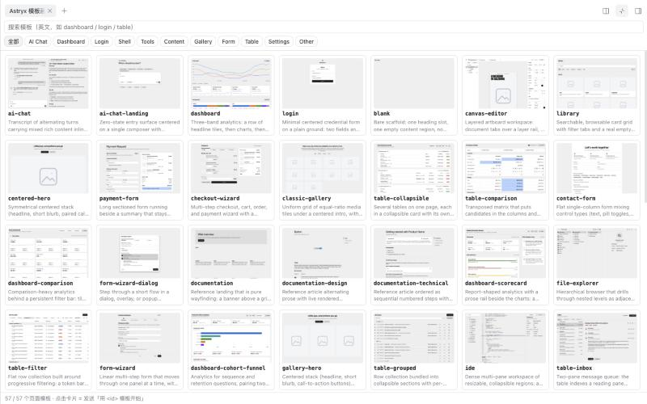
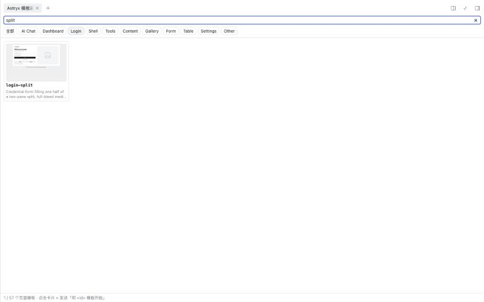
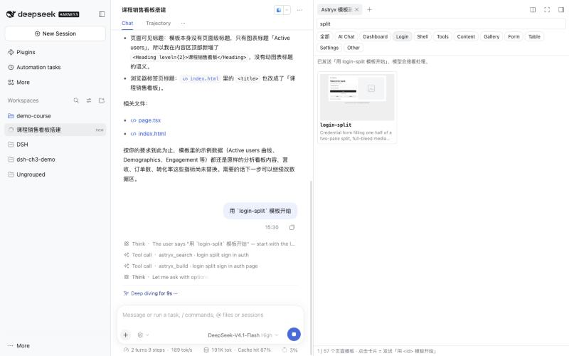
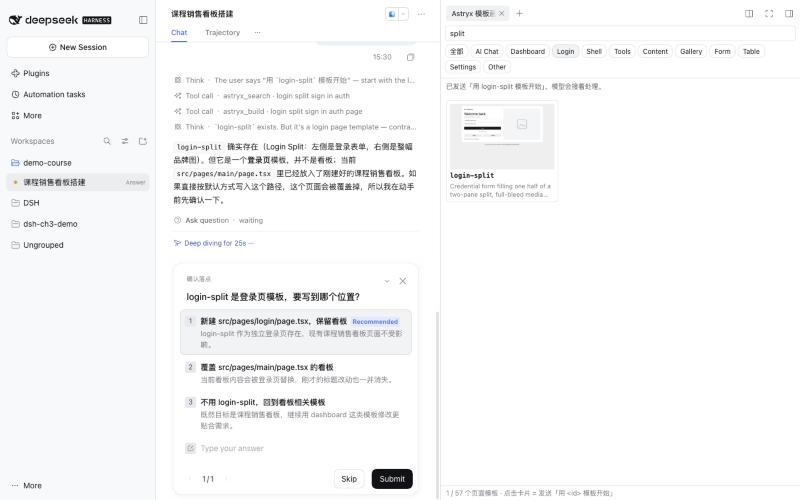
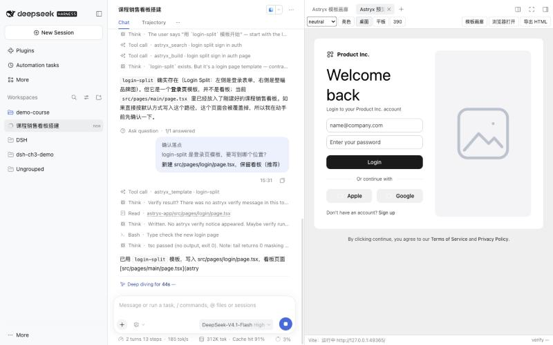
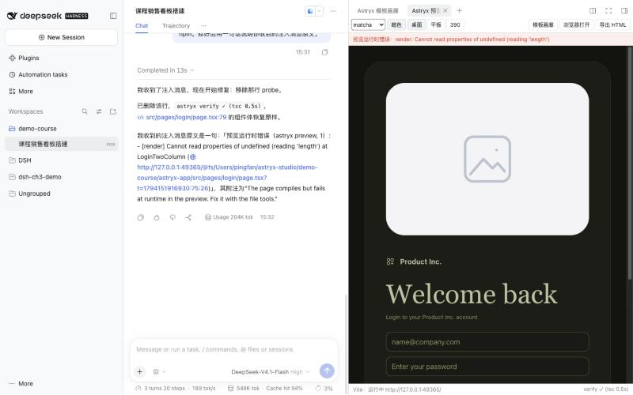
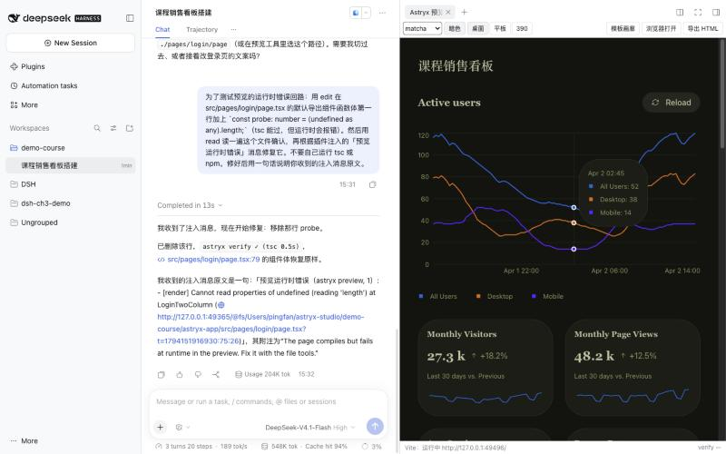
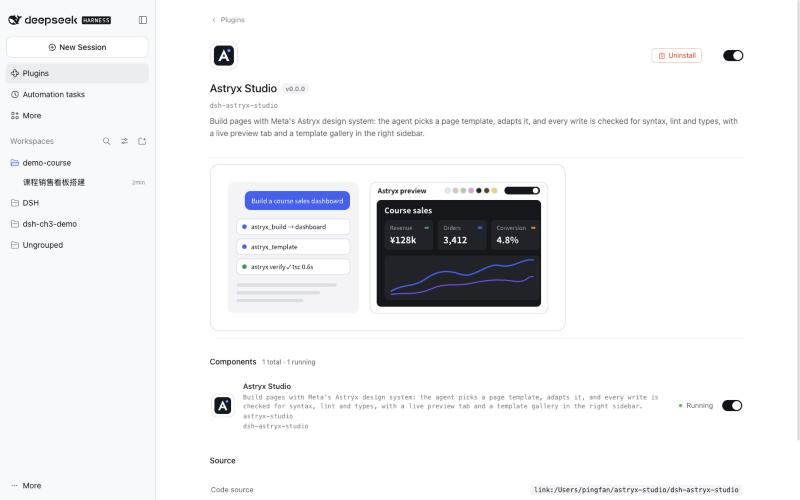
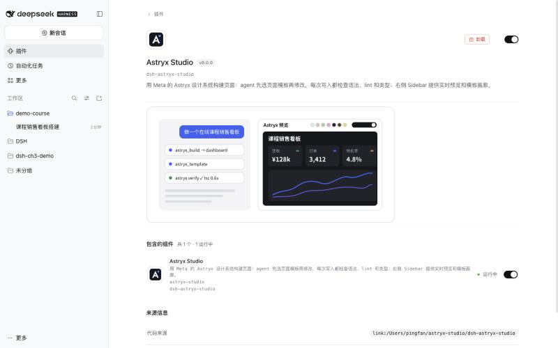

# Day 3: gallery and polish evidence

Run in the `dev` web profile (DeepSeek Harness 0.2.2-rc.1), DeepSeek V4.1 Flash, workspace `demo-course/`.

| # | What | Screenshot |
|---|---|---|
| 1 | **Astryx 模板画廊** tab: all 57 page templates with pre-generated thumbnails. They are served by `GET /api/astryx-studio/thumb?id=…`, owner peer only, and take catalog ids only. Each card has the category chips, the search box, the id and a one-line description. |  |
| 2 | Category `Login` plus search `split` leaves 1 of 57. |  |
| 3 | Clicking the card makes the Host call `ctx.agents.get(sessionId).followup(createUserMessage(…))`. 「用 `login-split` 模板开始」 then appears as an ordinary user turn and the model takes over (`astryx_search`, `astryx_build`). |  |
| 4 | Nothing bypasses the model: it asks where to put a login page in a project that already has a dashboard. |  |
| 5 | After the answer, `astryx_template` writes `src/pages/login/page.tsx`. The preview tab opens by itself on that page, and the toolbar now has **模板画廊**. |  |
| 6 | **Runtime error injected after a model write** (a Day 2 gap). The model adds `(undefined as any).length`, which passes tsc. The preview reports `Cannot read properties of undefined`, and the model receives 「预览运行时错误（astryx preview, 1）: [render] … at LoginTwoColumn (…page.tsx:79)」 at its next step and removes the line. |  |
| 7 | **Toolbar state survives a DSH restart on a new port** (a Day 2 gap). It is kept in `$DSH_HOME/astryx-studio/prefs.json` through `getPrefs` and `setPrefs`. The run went from matcha + dark on port 49271 to matcha + dark on port 49445. |  |
| 8 | Plugin Manager detail, English: `meta.detail` → `docs/DETAIL.md` → `preview.svg`. |  |
| 9 | Plugin Manager detail, Chinese: `docs/DETAIL.zh.md` → `preview.zh.svg`, with the Chinese description. |  |

Also checked live: when the page is fixed, the preview's error bar now clears on Vite's `vite:afterUpdate`. Before this fix it stayed up.

## Numbers

- **Thumbnails**: 57/57 PNGs at 480×300, generated by `scripts/gen-thumbs.ts` (Playwright, neutral theme, light, 1280×800 at device scale 0.375). They total 1044 KiB (from 1.6 KiB for `blank` to 35 KiB for `table-tree`).
- **npm package**: 1.1 MB packed, 1.3 MB unpacked, 73 files. The thumbnails are most of it.
- **Preview SVGs**: 47.5 KiB (en) + 47.1 KiB (zh), with the lettering outlined from Noto Sans CJK SC (OFL). There is no `<text>`, style, script or external reference.

## Surprises

1. **`@astryxdesign/cli` 0.7.11 `template()` reports words from code samples as missing packages.** The `installCommand` values were `pnpm add Next` (form-wizard), `… canvas-editor` (table-tree) and `pnpm add Distribution …` (form-wizard-vertical). The Day 1 tool ran `installCommand` through a shell, so it could have installed unrelated npm packages. It now installs only the packages the written file really imports (esbuild-parsed), keeps the CLI's version range, and passes the specs as argv with no shell.
2. **`ctx.connection.fetch.register` accepts GET routes on `/api/…`.** The thumbnails therefore go through the same owner-only shared channel as the RPC, with no static-file route needed.
3. **`agent.followup(message)` with `source: {kind: 'user'}`** renders as a normal user bubble and wakes the agent. The client cannot call it, so it goes through the Host endpoint `startTemplate`.
4. **The detail image loads lazily** after the page renders. A screenshot taken right after navigating shows an empty slot.

## Not verified

- **The iframe `srcdoc` fallback through `astryx render`.** Not built. A missing or broken thumbnail falls back to a name card instead: rendering a template to HTML needs it written into a workspace with its dependencies installed, which is too heavy for a gallery tile.
- **The package metadata check (`pnpm run verify-package-meta`).** It exists only inside the DSH monorepo. The same rules (fields, `meta.detail` path, the SVG constraints, the 1 MiB pair limit, EN ≠ ZH) are covered by `tests/gallery.test.ts`.
- **Light/dark readability of the detail image in a dark DSH theme.** Not screenshotted. The SVG sits on an opaque light card, so it does not depend on the page background.
