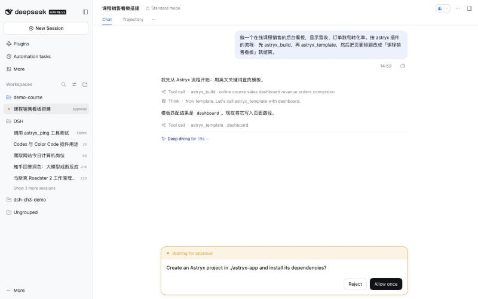
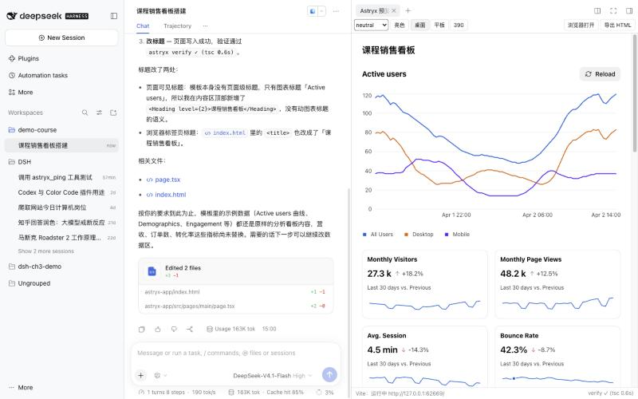
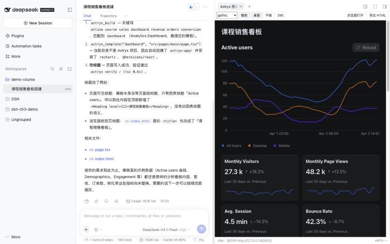
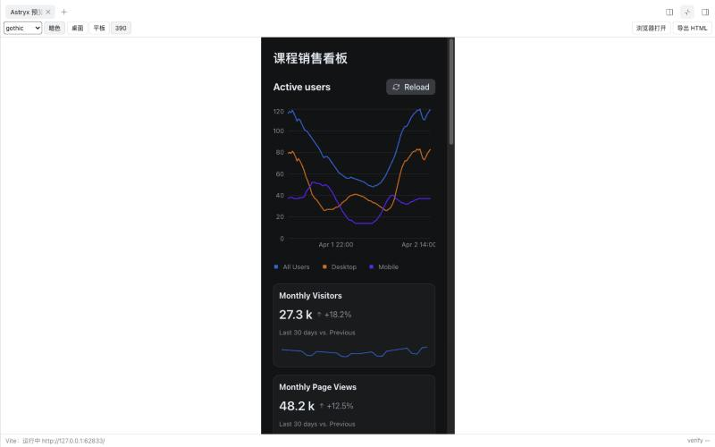
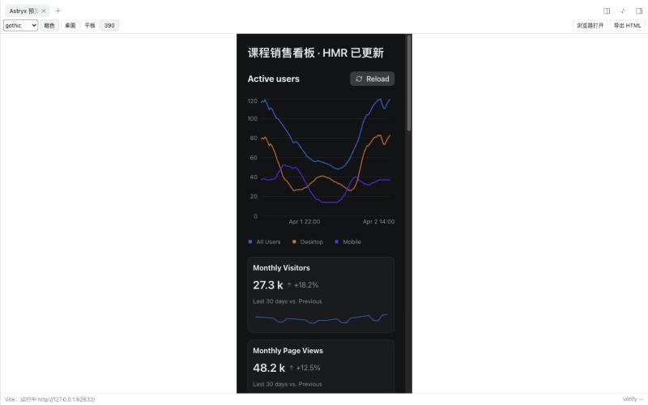
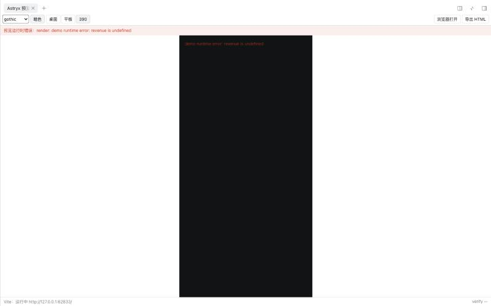
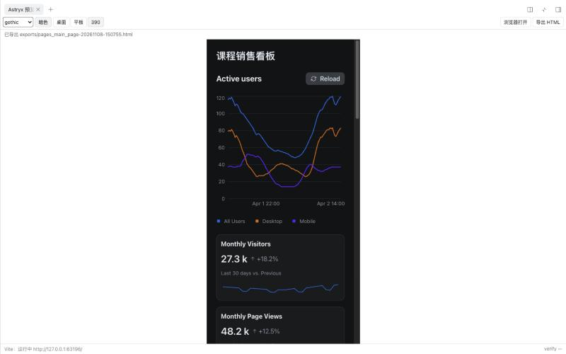

# Day 2: preview evidence

Run in the `dev` web profile (DeepSeek Harness 0.2.2-rc.1 desktop CLI), DeepSeek V4.1 Flash, on an **empty** folder `demo-course/` registered as a workspace.

The task given to the model was: 「做一个在线课程销售的后台看板……先 astryx_build，再 astryx_template，然后把页面标题改成「课程销售看板」就结束。」

| # | Step | Screenshot |
|---|---|---|
| 1 | The model calls `astryx_build`, then `astryx_template`. The folder is not an Astryx project, so the plugin's `tools/pre-execute` returns `ask` and DSH shows its own approval card ("Create an Astryx project in ./astryx-app and install its dependencies?"). |  |
| 2 | After **Allow once**, the plugin scaffolds `astryx-app/`, installs it, writes the template, writes `.astryx-studio/` and starts Vite through `ctx.subprocess`. The client sees the Host's open request and opens the **Astryx 预览** tab by itself. The footer reads `Vite：运行中 http://127.0.0.1:62669/` and `verify ✓ (tsc 0.6s)`. |  |
| 3 | The toolbar switches to theme `gothic` and dark mode. This happens by `postMessage` into the iframe: no reload, no recompile, and the model is not involved. |  |
| 4 | Width `390` (the sidebar is in fullscreen so the difference is visible). Theme, dark mode and width all survive a page refresh. |  |
| 5 | Editing `page.tsx` on disk: Vite HMR updates the iframe within about 2 s and keeps the theme state. |  |
| 6 | A runtime error (a temporary `throw` in the page). The error boundary in `.astryx-studio/main.tsx` catches it and posts it to the tab, which shows the red bar. The tab then reports it to the Host (`/api/astryx-studio/reportRuntimeError` → 200). This one is not injected, because the model has not written since the restart: that is the gating working. |  |
| 7 | **导出 HTML** runs `astryx render` and writes `exports/pages_main_page-<time>.html` (168 KB, self-contained). |  |

Also checked with a real Vite (opt-in integration test, `ASTRYX_E2E=1`):

- The page module is served (200).
- `secret.env` and `package.json` in the workspace root are refused through `/@fs` (403), because `server.fs.allow` only covers `.astryx-studio/`, `src/` and `node_modules/`.
- Vite exits together with DSH: nothing is left listening after DSH stops.

## DSH API surprises (0.2.2-rc.1)

1. **`connection.rpc.handle('/my-channel')` is unusable from a bundle plugin in the web profile.** It mounts its route through the *caller's* `ctx.webServer`. That service lives in the web app's isolated scope, so the call throws `cannot get property "webServer" without inject`. This happens even inside a sub-plugin that declares `inject: ['connection', 'webServer']`, and the throw is silent unless you wrap it. Fix used here: `connection.fetch.register()` exact routes under `/api/astryx-studio/<endpoint>`, owner peer only. These speak the Connection RPC wire format, so the client keeps using `connection.rpc.call('/api', 'astryx-studio/<endpoint>', payload)`.
2. **A scope from `ctx.inject([...], cb)` does not count as declaring those services** for cordis' property check. A sub-plugin, `ctx.plugin({ inject: [...], apply })`, is the way to depend on an optional service such as `subprocess` (missing in some profiles) without failing the whole plugin.
3. **The Host cannot push to the client.** The client polls a cheap status RPC (about 1 request/s in total) to learn about "open the preview" requests and status changes.
4. **The web profile's directory picker is native on macOS.** "Add workspace" opens an AppKit dialog via `osascript` on the desktop, not in the page. For this test the folder was registered through the web API's `workspace/create`.
5. **Tab bodies get their session through the slot's `inject(sessionId)` factory.** The returned face is spread into the body's props, so it goes under one key (`astryx`) to avoid clashing with the slot framework's own props.
6. **The `@astryxdesign/cli` `render()` API has three traps:**
   - It rejects `overwrite` outside `--reverse`.
   - It resolves `out` against the **process** cwd, not `options.cwd`.
   - It never replaces an existing git-ignored file.

   Exports therefore go to a fresh, timestamped file under `exports/`, with absolute paths.

## Not verified

- **The 「在 web-review 打开」 button.** dsh-web-review is not installed here. The button is hidden unless web-review's dock entry `webview-annotations` exists, and it opens the preview URL with `sidebarRight.openResourceIn()`, so web-review's URL tab only takes it if web-review claims http(s) addresses.
- **Restoring the toolbar state across a DSH restart on a random port.** It does not restore, because localStorage is per origin and `--port 0` changes the origin. It does restore across refreshes and restarts on the same port.
- **Model injection of a runtime error after a model write.** This is covered by unit tests (gating, dedupe, injection at `agent/pre-step`), not by a live model run.
- **The Vite crash → one restart path.** Covered with a fake subprocess only.
