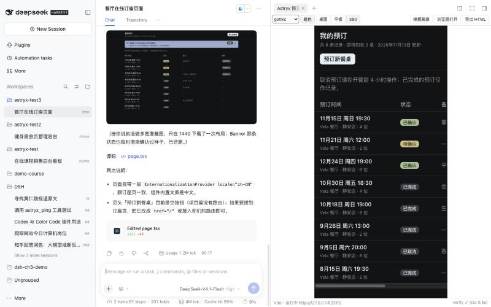
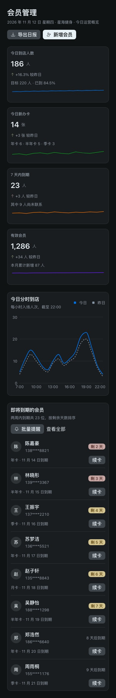
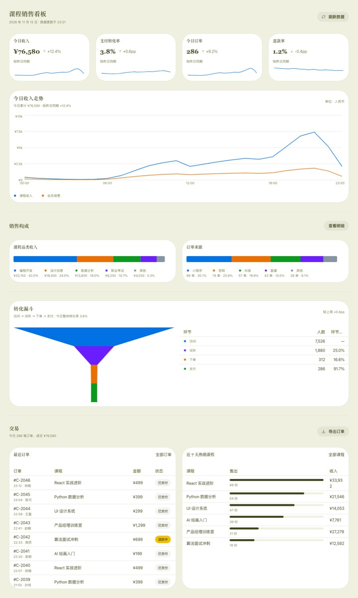

# Preview fixes and `astryx_screenshot` (2026-11-12/13)

Found by testing 0.1.0 in DSH 0.2.2-rc.1 (`dev` web profile, DeepSeek V4.1 Flash) on empty folders, then fixed and re-tested the same way.

## What the first run showed

Request: 「做一个在线课程销售的后台看板，要看到今日收入、转化率和最近订单」, then 「在销售构成下面加一个转化漏斗区块」.

| Problem | Effect |
|---|---|
| The preview's first load failed with `Failed to fetch dynamically imported module`, and the plugin passed it to the model. | The model spent 5 steps investigating a transient error. |
| After the model rewrote the template, the preview tab kept showing the template. A page reload fixed it. | The user sees the wrong page while the model reports success. |
| The model could not see the page. It built its own headless-Chrome pipeline, a temporary static server and iframe wrappers, and hit Chrome's ~500 px minimum window width on macOS. | 60 steps, about 4.7M tokens over two turns. |
| Gallery search only matched English (`表格` found nothing). | Unusable for the Chinese developers the plugin targets. |

## Causes and fixes

**Stale preview after a rewrite.** The harness holds the page component in React state. Fast Refresh only replaces a component in place when its identity is unchanged, and a rewritten template exports a different component (`DashboardPage` became `GymMembersPage`). Fast Refresh updated a component nothing rendered. Harness v5 re-imports the exact module version HMR just executed (`path?t=timestamp`) and renders its default export. React Refresh treats a same-family component as a no-op, so ordinary edits keep their state.

**First-load failure.** On a cold start Vite found `react-dom/client`, heroicons and `recharts` one by one while the page loaded, and reloaded after each one. The fixes:

- `optimizeDeps.entries` now scans the harness and every page up front, so dependencies are optimized in one pass.
- A page module that fails to *fetch* is retried with backoff for about 50 s behind a waiting message, and only then reported.
- After `astryx_template` or a `bash` command installs packages, a running preview Vite restarts. Vite keeps failed resolutions cached until it restarts.
- A tab watchdog reloads the iframe when a model write gets no HMR update within 4 s.

**Pages added while Vite runs.** `import.meta.glob('../src/**/*.tsx')` is fixed when Vite first transforms the harness. Files added later sit outside Vite's root and are not watched, so they showed `No page at …`. Pages now load by absolute `/@fs` URL. A GET probe tells a missing file (Vite answers its SPA `index.html`) from a transient failure.

**Seeing the page: `astryx_screenshot`.** Drives the installed Chrome / Chromium / Edge over the DevTools protocol, with no Playwright and no browser download. It uses `--headless=new` with an exact viewport, so 390 really is 390. It waits for `<html data-astryx-studio="ready|error">`, turns entry animations off, captures the full page, and returns the PNG path for DSH's `read_image` plus the page's console errors.

**Chinese gallery search.** A term map turns `表格`, `看板`, `登录表单` and similar terms into the English words the templates use. Glued terms are split longest first, and all of them must match.

## Re-test

| Run | Request | Result |
|---|---|---|
| Before | course sales dashboard + funnel | 2 turns, 60 steps, ~4.7M tokens; stale preview; first-load error reached the model |
| After, run 2 | 「健身房会员管理后台…做完确认一下手机宽度下没有撑破」 | 1 turn, 17 steps, 2.5 min, 715K tokens; the model checked 390 / 768 / 1440 with `astryx_screenshot` + `read_image`. The preview was still stale, which led to the v5 fix above. |
| After, run 3 | 「餐厅的在线订座页面」 | 4 min 19 s; the preview followed the template rewrite live; four widths checked by screenshot |
| After, run 4 | 「再做一个独立的"我的预订"页面，放在 src/pages/my-bookings/page.tsx」 while the preview ran | 1 min 20 s; the tab switched to the new page and followed its edits |
| After, run 5 | 「做一个体检预约表单…只在 1440 截一次图确认」 on a fresh folder, with the `locale` default | 1 turn, 20 steps, 1 min 45 s, 672K tokens; field labels show 「必填」 with no localization code in the page (run 3 spent several steps adding it) |

Also checked by hand:

- Renaming the page's default component shows within about 3 s in the preview tab. With harness v4 it stayed on the old page.
- `kill -9` on the preview Vite: the Host restarted it on a new port, and the iframe followed.
- Hiding `recharts` and clearing the Vite cache: the preview shows 「正在等待依赖安装或预构建完成…」 and backs off. After a Vite restart it recovers and clears its retry counter.
- Five templates written after Vite started all load and report ready. A missing page reports `error` at once.
- Stopping DSH stops every preview Vite.

